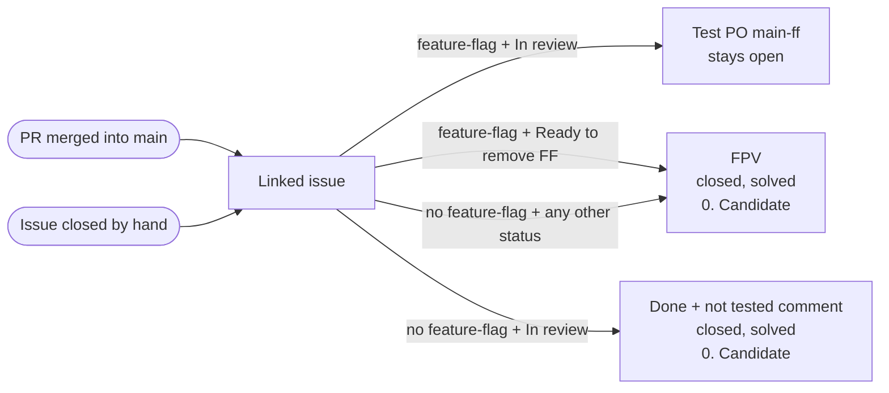

# Sync Project Status on PR Merge

## How it works



An issue already in `Done` or `FPV` keeps its status. Any other case (e.g. an issue in `Test PO main-ff` or `Main-ff validated`) is left untouched.

## Linking a PR to its issue

Any of these, all equivalent:

- `(#n)` at the end of the PR title;
- `Closes #n` in the PR body (`Fixes` and `Resolves` work too);
- the issue linked in the PR's Development panel.

For a `feature-flag` issue, use only `(#n)`: the other two make GitHub close the issue at merge.

An issue of another repository of the same owner (e.g. `filigran-private`) is synced too when linked in the Development panel
or with `Closes owner/repo#n`; the title `(#n)` only reads the PR's repository.

## Usage

```yaml
name: "[OpenAEV] Sync Project Status on PR Merge"

on:
  pull_request:
    branches: [ main ]
    types: [ closed ]
  issues:
    types: [ closed ]
  workflow_dispatch:
    inputs:
      pr_number:
        description: 'PR number to be (re)processed manually'
        required: true
        type: string

jobs:
  sync-status:
    if: github.event_name == 'workflow_dispatch' || github.event_name == 'issues' || github.event.pull_request.merged == true
    runs-on: ubuntu-latest
    steps:
      - name: Generate a token
        id: generate-token
        uses: actions/create-github-app-token@v3
        with:
          app-id: ${{ secrets.OPENAEV_PR_CHECKS_APP_ID }}
          private-key: ${{ secrets.OPENAEV_PR_CHECKS_PRIVATE_KEY }}
          owner: ${{ github.repository_owner }}

      - name: Sync status
        uses: FiligranHQ/filigran-ci-tools/actions/sync-status-on-merge@main
        with:
          token: ${{ steps.generate-token.outputs.token }}
          pr-number: ${{ github.event.inputs.pr_number || '' }}
          project-owner: "OpenAEV-Platform"
          project-number: "2"
```

Optional inputs, with their defaults: `feature-flag-label` (`feature-flag`),
`target-milestone` (`0. Candidate`), `fallback-status` (`Final product validation`).

The token needs Issues read/write, Pull requests read and Projects (org) read/write.
With `owner`, it also reaches the issues of the other repositories where the app is installed.

## Testing

`main.js` runs the flow and `logic.js` holds the rules; GitHub calls live in the shared `actions/lib`. Run the rule tests with:

```bash
node --test actions/sync-status-on-merge/logic.test.js
```